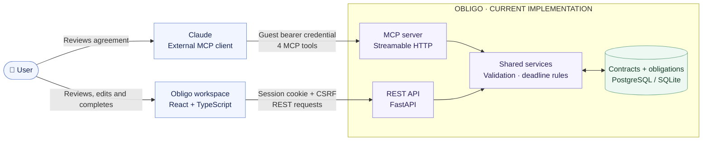
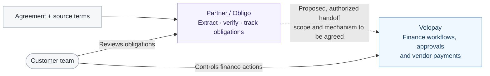

<div align="center">

# Obligo

### From contractual commitments to accountable execution.

**A contract obligation workspace powered by your Claude account through MCP.**

[**Live demo**](https://obligo-workspace.vercel.app) · [**MCP endpoint**](https://obligo-workspace-api.vercel.app/mcp)

</div>

---

## The problem

A signed contract is not the end of the work. It can contain renewal windows, notice periods, approvals, and responsibilities that someone needs to act on months later.

Those commitments often remain buried in documents or scattered across calendars and spreadsheets. Reading a contract is a one-time task; **following through is an ongoing operational responsibility**.

## The product

**Obligo turns contract terms into trackable obligations.**

A user reviews an agreement with Claude and asks it to create a contract in Obligo. Through the Model Context Protocol (MCP), Claude sends structured records into the workspace. The team can then verify the extracted terms, correct owners and dates, and track what is due — without keeping Claude open.

| Claude handles | Obligo handles |
| --- | --- |
| Reading and interpreting the agreement | Persisting contracts and obligations |
| Identifying possible deadlines and actions | Human review and edits |
| Structuring information for MCP tools | Deadline status and completion tracking |

**No model inference runs inside Obligo.** The user brings their own Claude access; the application provides the persistent workflow.

## How it works

```text
Agreement → Claude → Obligo MCP tools → Database → Workspace
                                                 ↓
                                Review → Assign → Track → Complete
```

1. **Connect Claude.** Open Obligo as a guest and follow the in-app **Connect Claude** guide.
2. **Create a contract.** Give Claude a vendor agreement and ask it to save the relevant terms using Obligo's MCP tools.
3. **Verify the extraction.** Review source clauses, owners, and deadlines before approving obligations.
4. **Manage the work.** Edit records, monitor upcoming or overdue obligations, and mark actions complete in Obligo.

> **Product principle:** Claude helps interpret the contract. Obligo makes the work visible and accountable after the conversation ends.

## Built for the operational handoff

- **Contract register** — vendor agreements, renewal dates, and notice periods in one place.
- **Obligation tracking** — actionable items tied to their source contract.
- **Human-in-the-loop review** — AI-extracted terms remain pending review until approved.
- **Deadline visibility** — due-soon, due-today, overdue, and completed states.
- **Guest demo workspaces** — isolated sessions and workspace-specific MCP credentials.
- **Editable records** — changes persist independently of the Claude conversation.

## Architecture

### What is built today



Claude is a separately operated client: it interprets information provided by the user and calls Obligo's tools. Obligo does not call an AI inference API. The web app and MCP server use the same service layer and workspace-scoped records. The live deployment uses Vercel and Neon PostgreSQL; local development uses SQLite.

| Layer | Implementation |
| --- | --- |
| Frontend | React · TypeScript · Vite |
| API | FastAPI · Python |
| AI-to-app interface | Model Context Protocol (MCP), Streamable HTTP |
| Persistence | PostgreSQL (Neon); SQLite for local development |
| Deployment | Vercel |
| Icons and interface | Lucide · minimalist operational UI |

Obligo exposes four MCP tools: `create_contract`, `add_obligation`, `list_contracts`, and `list_obligations`. These use the same persistent business records as the web application.

### Data flow

1. A visitor starts a guest session. The live demo creates a private workspace with clearly labeled fictional sample records.
2. The user supplies an agreement to Claude and asks it to save structured contract details and obligations. Claude sends tool calls to Obligo over authenticated Streamable HTTP; raw agreement upload and document storage are not implemented by Obligo.
3. FastAPI validates the calls and the shared services persist records. New extracted obligations start as **pending review**, with source clauses when supplied.
4. The frontend reads the same records through the REST API. A person checks and edits the details, approves an obligation, and can mark it complete.
5. Deadline labels are calculated deterministically from the workspace's configured timezone and date-only due dates. Completed and pending-review states take precedence over deadline states.

### Where Volopay and a partner could fit

Volopay describes [accounts payable](https://www.volopay.com/accounts-payable/), vendor payment workflows, and [accounting integrations](https://www.volopay.com/accounting-automation/) as parts of its finance platform. Contract commitments could complement those workflows by making renewal and notice obligations visible before a finance action is needed. This is a **product hypothesis**, not an existing integration or an endorsement by Volopay.



| Responsibility | Proposed owner | Status |
| --- | --- | --- |
| Contract capture, source clauses, obligation review and deadline tracking | Partner / Obligo | Built in the MVP as structured records; document storage is not implemented |
| Spend controls, finance approvals and vendor-payment workflows | Volopay | Existing product area described in Volopay's public materials; no connection to Obligo exists |
| Identity, tenant mapping, permissions, data exchange and support ownership | Volopay and partner together | To agree and validate; APIs, access and commercial terms are unconfirmed |
| Confirming contractual meaning and authorizing any finance action | Customer | Human responsibility; not automated by Obligo |

No Volopay API calls, payment initiation, spend controls, or account linking are implemented in this repository. A production handoff would depend on approved interfaces and explicit customer authorization.

### Assumptions, limitations and next steps

| Area | Current MVP / assumption | Next step for a production system |
| --- | --- | --- |
| Extraction | A user supplies content to Claude; model output can be wrong or incomplete. | Validate extraction quality with real review workflows; retain provenance and versioned source documents with consent. |
| Identity and access | Guest workspaces use expiring sessions and workspace-specific MCP credentials. They are designed for a demo, not organization-wide access. | Design tenant identity, roles, lifecycle controls and a supported connector authorization flow. |
| Integration | Volopay is a proposed adjacent platform. No integration contract, API access or partnership is assumed. | Confirm customer need, partner responsibilities, supported APIs, scopes and event/data mappings with Volopay. |
| Operations | Statuses appear in the workspace; notifications, background reminders and durable audit history are not implemented. | Add appropriate monitoring, auditability, backups, retention and reminder workflows. |
| Deployment | The live demo uses isolated guest workspaces and fictional sample data. Claude.ai connectivity itself has not been independently verified. | Validate the complete connector flow, reliability and security before handling confidential contracts. |

The implementation uses React, TypeScript, Vite, FastAPI, the official Python MCP SDK, SQLAlchemy, Pydantic, PostgreSQL, SQLite and Playwright. Claude is an external client, not a bundled dependency.

## Try Obligo

**[Open the live demo](https://obligo-workspace.vercel.app)**

1. Select **Continue as Guest**.
2. Click **Connect Claude** and follow the guided connector setup.
3. Use a fictional sample vendor agreement in Claude to create a contract and obligations.
4. Return to Obligo to review, edit, and track them.

**Remote MCP URL:** `https://obligo-workspace-api.vercel.app/mcp`

A guest-specific authorization credential is required. Obtain it inside the application; do not use a shared token or publish credentials in a repository.

## Run locally

Requirements: Python 3.13, Node.js and npm. From the project root, start the backend in PowerShell:

```powershell
cd backend
py -3.13 -m venv .venv
.\.venv\Scripts\python -m pip install -r requirements.txt
Copy-Item .env.example .env
.\.venv\Scripts\python -m uvicorn app.main:app --reload
```

In a second terminal, start the frontend:

```powershell
cd frontend
npm ci
npm run dev
```

Open `http://localhost:5173` and continue as a guest. Local development uses SQLite. Set a long random `MCP_BEARER_TOKEN` in `backend/.env` for master-token access; never commit that file. The local MCP endpoint is `http://127.0.0.1:8000/mcp`; the in-app remote connector guide requires a publicly reachable HTTPS endpoint.

Run checks with `npm run build` and `npm run test:ui` from `frontend`, and `.\.venv\Scripts\python -m unittest discover -s tests -v` from `backend`. The browser test uses Chrome on Windows by default; set `CHROME_PATH` if needed.

## Product scope & limitations

Obligo is a **working assignment MVP**, not a legal-advice service or a production-ready enterprise contract lifecycle management suite. Contract interpretation can be incomplete or incorrect; people must verify source clauses and dates before relying on them. Guest access is intended for testing with fictional, non-confidential agreements, and demo workspaces expire.

The initial product hypothesis is straightforward: teams may pay to reduce missed contractual actions and make ownership explicit. **Willingness to pay and measurable business impact have not yet been validated.**

---

<div align="center">

**Obligo** · Contracts shouldn't become forgotten commitments.

</div>
